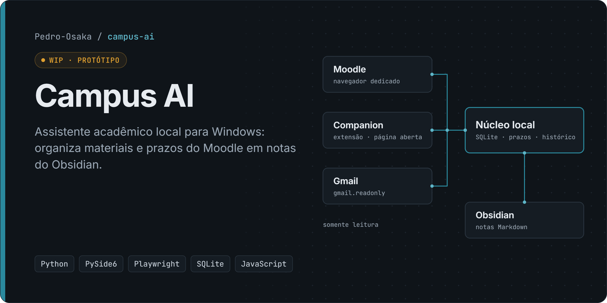
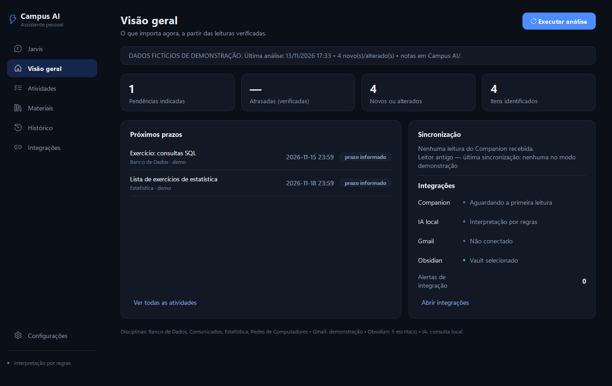
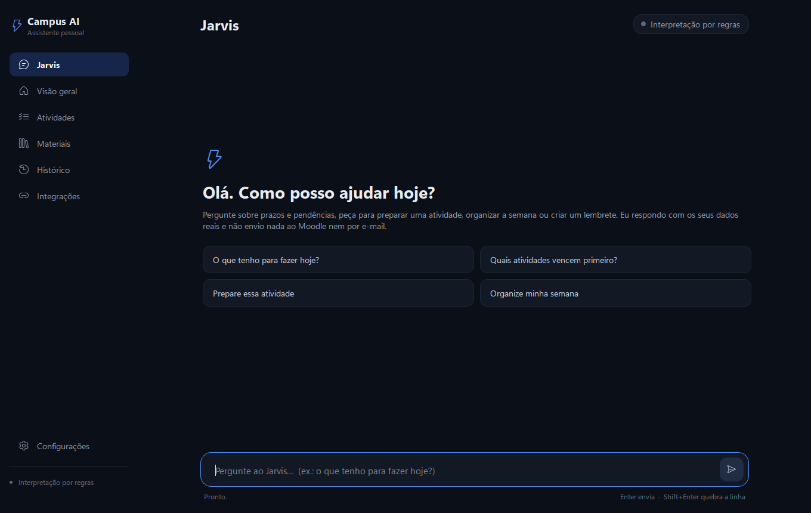

# Campus AI

> **Status: WIP (protótipo).** Funciona em modo de demonstração e com páginas simuladas. Ainda **não foi validado de ponta a ponta com contas reais**. Não é um aplicativo oficial de nenhuma instituição.

Assistente acadêmico local para Windows. Lê materiais, atividades e prazos de uma disciplina no Moodle e organiza tudo em notas Markdown no Obsidian, com histórico local e alertas de novidades.

**[Portfólio](https://pedro-osaka.github.io/portfolio/)** · **[Perfil no GitHub](https://github.com/Pedro-Osaka)**

## Problema

Acompanhar várias disciplinas num AVA Moodle exige abrir cada página para descobrir o que foi publicado e o que vence. Comunicados chegam por e-mail, separados do resto. O objetivo é um painel único e local, sem servidor e sem entregar a senha do aluno a ninguém.

## Funcionalidades

- Interface desktop PySide6 com modo **Demonstração** (dados fictícios), agente na bandeja e instância única.
- Leitura de uma disciplina por **navegador dedicado** (Playwright) com perfil próprio e login manual: abre seções recolhidas e navega por cartões só depois de validar o destino.
- Extensão **Companion**: lê a página que o aluno já abriu, mostra uma prévia e só salva depois de um clique.
- Conector **Moodle REST** (web services clássicos) para quando a instituição fornecer um token autorizado.
- **Gmail** com OAuth para desktop, escopo `gmail.readonly`: lista mensagens recentes e classifica comunicados.
- Notas no **Obsidian** sob `Campus AI/`, com `Painel Acadêmico.md`, preservando as edições manuais.
- Histórico em **SQLite**, para não repetir alertas.

## Tecnologias

Python 3.11+ · PySide6 · Playwright · SQLite · requests · keyring · Google API Client (Gmail) · JavaScript (extensão Chromium, Manifest V3) · PowerShell · unittest · node:test

## Demonstração

Capturas da interface em **modo Demonstração**, com dados fictícios gerados pelo próprio app (o aviso aparece no topo da tela). Capturadas em 13/11/2026, a partir desta versão do repositório.





## Princípios de projeto

- **Somente leitura.** O app nunca envia, conclui, baixa nem altera nada no Moodle.
- **O aluno faz o login.** No modo navegador, o login é feito pelo próprio aluno numa janela visível; o app não recebe nem guarda a senha.
- **Escopo autorizado.** A leitura fica limitada às disciplinas autorizadas (hoje, uma disciplina piloto).
- **Honestidade sobre cobertura.** Cada leitura é classificada como completa, parcial, não validada ou erro. Uma seção sem evidência nunca é tratada como vazia.
- **Dados locais.** SQLite e Markdown ficam na máquina do aluno. Tokens OAuth ficam no cofre de credenciais do Windows (`keyring`).

## Arquitetura

```
┌──────────────────────┐   native messaging   ┌──────────────────────────┐
│ Extensão "Companion" │ ───────────────────▶ │ Host local (Python)      │
│ JS, Chrome/Edge      │   contrato versionado│ companion_host.py        │
│ lê a página aberta   │   campus-ai.academic │ valida e persiste        │
└──────────────────────┘                      └────────────┬─────────────┘
                                                           │
┌──────────────────────┐                      ┌────────────▼─────────────┐
│ Navegador dedicado   │ ───────────────────▶ │ Núcleo (engine, state,   │
│ Playwright, perfil   │   leitura assistida  │ contract, deadlines)     │
│ próprio, login manual│                      │ SQLite: histórico e      │
└──────────────────────┘                      │ notificações             │
┌──────────────────────┐                      └────────────┬─────────────┘
│ Gmail API (readonly) │ ───────────────────▶             │
└──────────────────────┘                      ┌────────────▼─────────────┐
                                              │ Obsidian (Markdown)      │
  Interface: PySide6 (bandeja, instância      │ Painel Acadêmico + notas │
  única, modo demonstração)                   └──────────────────────────┘
```

Detalhes e decisões: [`ARCHITECTURE_3.md`](ARCHITECTURE_3.md) · Integração da extensão: [`docs/INTEGRACAO_COMPANION.md`](docs/INTEGRACAO_COMPANION.md)

| Pasta | Conteúdo |
|---|---|
| `campus_ai/` | Aplicativo Python: interface, núcleo, conectores Moodle e Gmail, escrita no Obsidian, host da extensão |
| `companion/` | Extensão de navegador (JavaScript, sem dependências) e testes `node --test` |
| `tests/` | Suíte `unittest`, isolada dos dados reais; fixtures **100% fictícias** |
| `scripts/` | PowerShell: instalação, abertura, testes, início com o Windows, host da extensão, geração do EXE |
| `docs/` | Documentação técnica; `docs/historico/` guarda as notas de desenvolvimento por etapa |

## Como executar

Requisitos: Python 3.11+ e, opcionalmente, Obsidian e Node.js 20+ (para os testes da extensão).

```powershell
git clone https://github.com/Pedro-Osaka/campus-ai.git
cd campus-ai
powershell -NoProfile -ExecutionPolicy Bypass -File .\scripts\instalar_windows.ps1   # cria a .venv e instala dependências
powershell -NoProfile -ExecutionPolicy Bypass -File .\scripts\abrir_windows.ps1      # abre a interface
```

Na interface, abra **Configurações**, escolha a pasta do vault do Obsidian, mantenha o modo **Demonstração** e clique em **Iniciar análise**.

Testes:

```powershell
powershell -NoProfile -ExecutionPolicy Bypass -File .\scripts\executar_testes.ps1    # Python
cd companion; npm test                                                               # extensão
```

O uso com contas reais (token Moodle, OAuth do Gmail, perfil do navegador) e as precauções de segurança estão em [`docs/historico/NOTAS_DE_DESENVOLVIMENTO.md`](docs/historico/NOTAS_DE_DESENVOLVIMENTO.md).

## Testes

| Suíte | Resultado (11/11/2026) |
|---|---|
| Python `unittest` (`tests/`) | **566 testes OK**, 97 pulados: 92 exigem Chromium (opt-in com `CAMPUS_AI_BROWSER_SMOKE=1`), 3 exigem a `.venv` dentro do projeto e 2 são smoke tests manuais |
| JavaScript `node --test` (`companion/`) | **97 testes OK** |

A suíte redireciona `LOCALAPPDATA` para uma pasta descartável e **falha se qualquer dado real mudar** (`tests/test_zzz_real_data_untouched.py`).

## Limitações e status

**Status atual: WIP (protótipo).** Funciona em modo de demonstração e com páginas simuladas.

- Nenhum fluxo foi validado de ponta a ponta com conta institucional real. A estrutura do AVA foi observada uma vez, só de forma estrutural ([`docs/poc/`](docs/poc/RESULTADO_ESTRUTURAL_7653.md)), sem ler conteúdo.
- Os seletores foram ajustados a um tema específico de Moodle (formato "Tiles") e podem precisar de adaptação em outras instalações.
- A leitura por navegador fica restrita a uma disciplina piloto; "Trilhas de Aprendizagem" ainda não é lida.
- O Gmail não baixa nem interpreta anexos.
- Não há instalador assinado; o EXE é gerado localmente com PyInstaller.

## Autor

**Pedro Henrique da Silva Pereira** · [Portfólio](https://pedro-osaka.github.io/portfolio/) · [LinkedIn](https://www.linkedin.com/in/pedrosilva-sistemas/)

Desenvolvido com auxílio de assistentes de IA (Claude Code, Codex). As decisões de arquitetura, as regras de segurança e a validação por testes são minhas.
